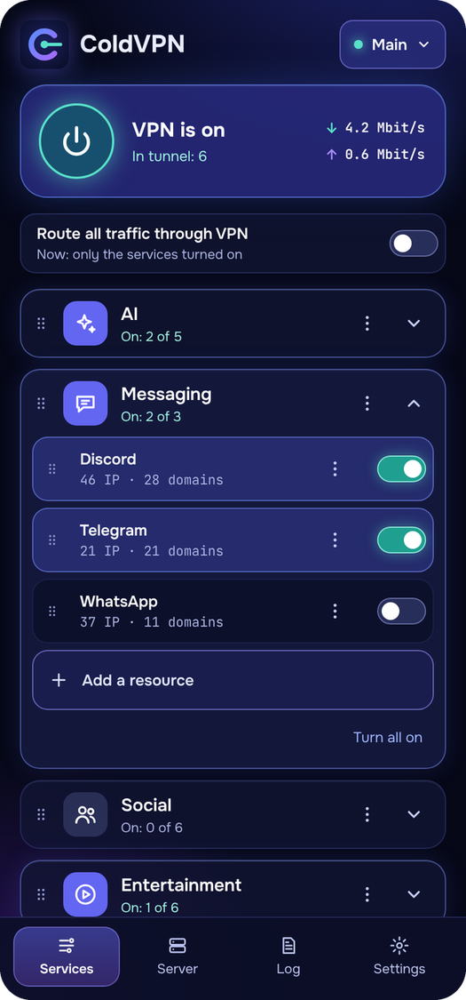
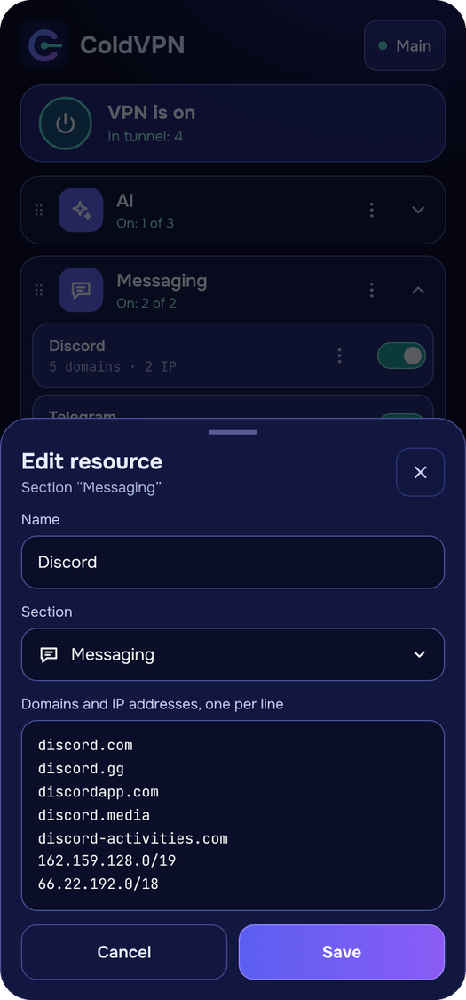
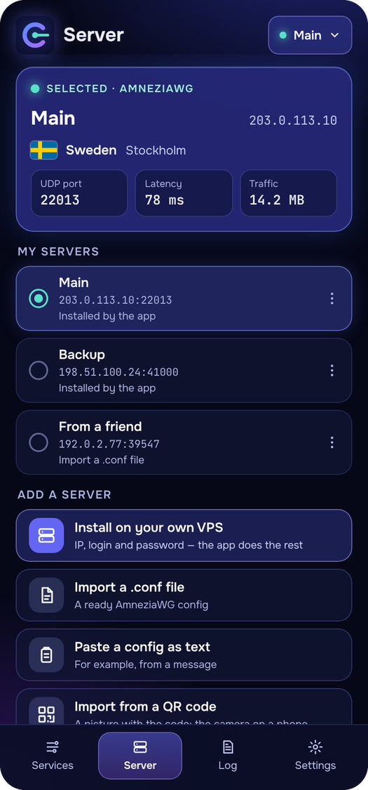
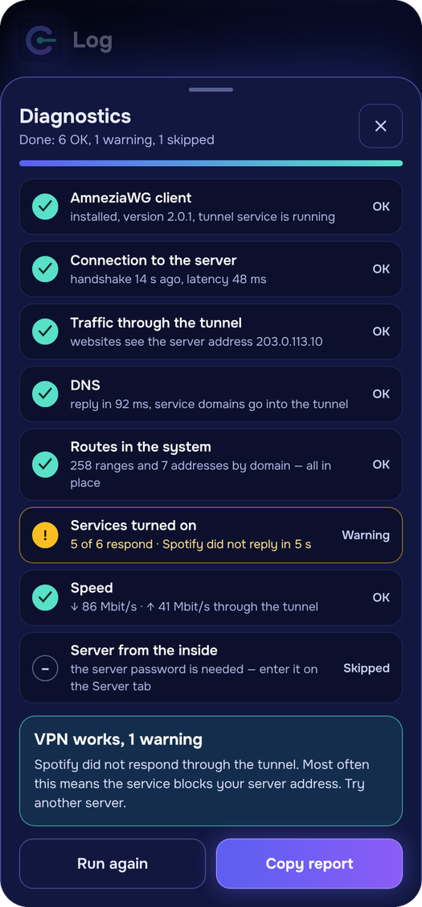
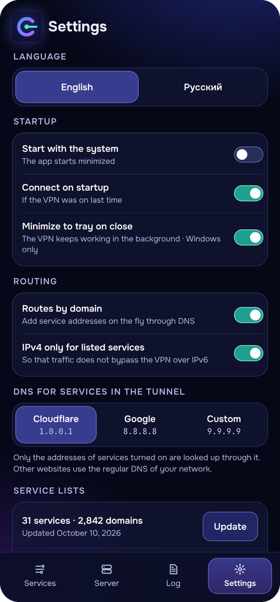

# ColdVPN

[Русский](README.md) · **English**

<p align="center">
  
  
  
  
  
</p>

| Services | Your own resources | Server | Diagnostics | Settings |
|---|---|---|---|---|
| Only what you turn on goes through the VPN | Edit any list or create your own | Install on a VPS with an address, login and password | Eight checks with a clear verdict | English and Russian, autostart, DNS |

A VPN client built on AmneziaWG with split tunnelling: the app installs a VPN
server on your own VPS and sends only the services you choose through it.
Everything else goes directly through your provider.

Current version: **0.1.3**, for **Windows 10/11 (x64)** and **Android 8.0+**.

## Features

- **One-step server installation.** A VPS address, login and password are
  enough: the app signs in over SSH and installs AmneziaWG in Docker.
- **Split tunnelling.** Resources are grouped into sections (AI, messaging,
  social, entertainment, games, system), and each one is turned on
  separately. There is also an “All traffic through VPN” mode.
- **Your own sections and resources.** Any section or resource can be
  renamed, edited or deleted, and you can add your own with your own
  domains, addresses and ranges. Resources can be dragged within a section
  and between sections. Edits to the built-in lists survive list updates.
- **Routes by domain** (Windows). Service addresses are added to the tunnel
  on the fly when a program contacts a domain from the list.
- **Apps mode** (Android). The selected phone apps go through the VPN
  entirely.
- **Several servers** with quick switching, a country flag and a city.
- **Config import and sharing**: a `.conf` file, a QR code or text. A
  separate key can be issued for a friend or a second device.
- **Diagnostics**: client, connection to the server, DNS, routes, service
  availability, speed, server state.
- **Service list updates** straight from the source repositories.
- Autostart, starting minimized, running from the tray, moving settings
  between devices.
- **Built-in guide** to every feature: Settings → About → User guide.
- Interface in English and Russian; the language is switched in Settings.
- **Chrome extension** (Windows): turns the VPN on for the browser only — for all sites or for your own list of favourites — and adds the site of the open tab to ColdVPN. It is loaded from the `chrome_extension` folder next to the app.

## Installation

Ready-made files are on the
[Releases](https://github.com/ColdVision/ColdVPN/releases) page.

**Windows.** Download `ColdVPN-Setup-<version>.exe`. The installer is not
signed, so Windows shows a SmartScreen warning: “More info” → “Run anyway”.
The app runs as administrator: without that it cannot install the tunnel
service or change routes.

**Android.** Download `ColdVPN-<version>.apk` and open it on the phone. The
system asks to allow installation from this source, as it does for any app
from outside a store.

## How to use

1. Rent a VPS with Ubuntu or Debian.
2. Server tab → “Install on your own VPS”: enter the IP address, login and
   password. If you already have an AmneziaWG server, add its config as a
   file, a QR code or text.
3. On the Services tab turn on the resources you need and press the power
   button. On Windows the first connection downloads and installs the
   official AmneziaWG client.
4. To connect a phone or a second device, open the server menu on the
   Server tab → “Share” and issue a separate key.

## Building from source

Windows 10/11 x64 and administrator rights are required.

- `install_and_build.bat` installs what is missing (Git, Visual Studio Build
  Tools, Flutter) and builds the app into
  `build\windows\x64\runner\Release\`.
- `build_installer.bat` does the same and packs an installer,
  `dist\ColdVPN-Setup-<version>.exe` (Inno Setup is needed; the script
  installs it).
- `build_android.bat` installs the JDK and Android SDK and builds
  `dist\ColdVPN-<version>.apk`. The first build creates a permanent signing
  key in `Documents\ColdVPN-signing`. Keep a copy of that folder: an update
  installs over the old version only when the key is the same.
- `publish_to_github.bat` pushes the source code to the repository and
  helps to publish a release.

If the tools are already installed, this is enough:

```powershell
powershell -ExecutionPolicy Bypass -File tool\setup_windows.ps1
```

Tests: `flutter test`.

## How it works

- **Server.** `assets/install_awg.sh` starts a container from the
  `amneziavpn/amneziawg-go` image. Keys and obfuscation parameters are
  created on the server and kept in `/opt/splitvpn/awg`; installing again
  does not change them. Every device has its own key and address.
- **Windows client.** The tunnel runs as a service of the official
  AmneziaWG client. `AllowedIPs` in the config holds the ranges of the
  resources turned on, so Windows adds routes only for them.
- **Android client.** The tunnel is brought up by the bundled AmneziaWG
  library. In Services mode the IP lists are used; in Apps mode the
  selected apps go through the VPN entirely.
- **Routes by domain.** While connected, the app runs a local DNS proxy and
  sets it as the DNS server of the tunnel. When a program asks for a name
  from the list of a resource that is turned on, the proxy resolves it,
  adds routes for the addresses to the tunnel and only then replies. Other
  names are resolved by the regular system DNS.
- **Service lists.** `assets/services.json` is built from two repositories
  as described in `assets/selection.json`. The app can update the lists
  itself; `tool/build_services.py` rebuilds them by hand.

### Layout

| Path | Contents |
|---|---|
| `lib/app_state.dart` | App state, connection, diagnostics |
| `lib/awg_config.dart`, `lib/awg_manager.dart` | Tunnel config and control of the AmneziaWG client |
| `lib/android_tunnel.dart`, `android_src/` | The tunnel on Android |
| `lib/dns_proxy.dart` | DNS proxy for routes by domain |
| `lib/l10n.dart` | English translation: strings in the code are written in Russian and serve as keys |
| `lib/server_installer.dart` | Server installation over SSH |
| `lib/list_updater.dart` | Service list updates |
| `lib/secret_store.dart` | Storage of the server password |
| `lib/desktop.dart` | Window and tray icon |
| `lib/ui/` | Screens and shared interface elements |
| `assets/` | Lists, server scripts, fonts, icons, flags |
| `installer/`, `tool/` | Installer and build scripts |
| `docs/` | Screenshots and the changelog |

## Data and security

- Servers, sections, resources and settings are stored in the user profile
  (on Windows, `%APPDATA%\com.splitvpn\split_vpn`). Server keys are kept
  there in plain form, as in an ordinary WireGuard config.
- The VPS password is saved only if you ask for it. On Windows it is
  encrypted with Windows data protection (DPAPI) for the current account;
  on Android it is kept only until the app is closed.
- The country and city of a server are detected with a single request to
  ip-api.com, which receives the server IP address. The location can also
  be entered by hand.
- Updating the lists downloads the archives of two repositories from GitHub.

## Sources and credits

- IP ranges: [RockBlack-VPN/ip-address](https://github.com/RockBlack-VPN/ip-address)
- Domains: [v2fly/domain-list-community](https://github.com/v2fly/domain-list-community)
- Protocol and client: [AmneziaWG](https://github.com/amnezia-vpn)
- Fonts [Onest](https://fonts.google.com/specimen/Onest) and
  [JetBrains Mono](https://www.jetbrains.com/lp/mono/) — SIL OFL licence,
  the texts are in `assets/fonts/`
- Flags: [hampusborgos/country-flags](https://github.com/hampusborgos/country-flags)
