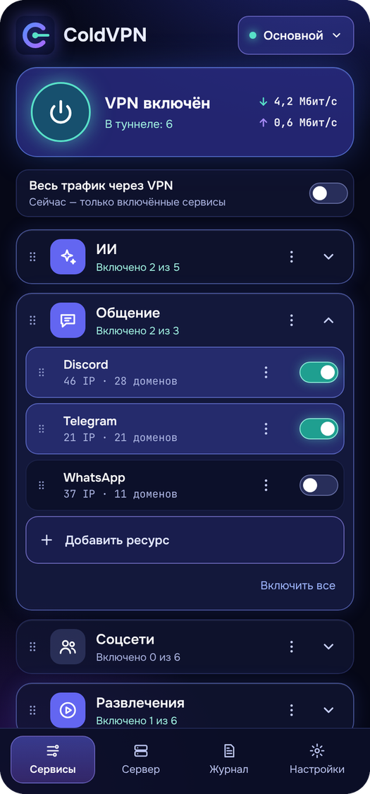
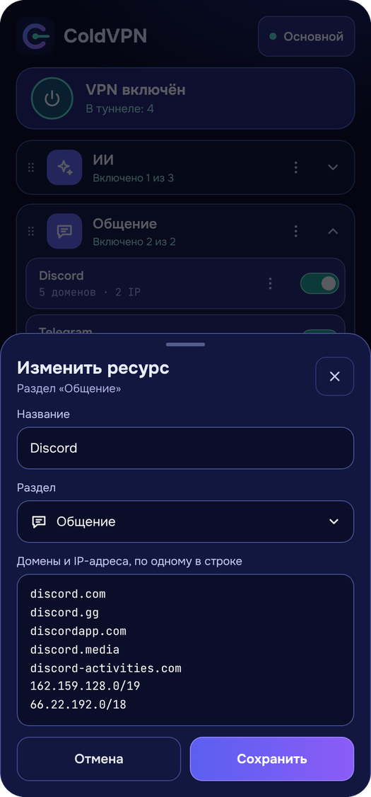
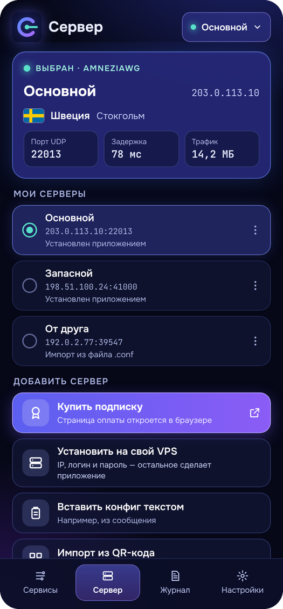
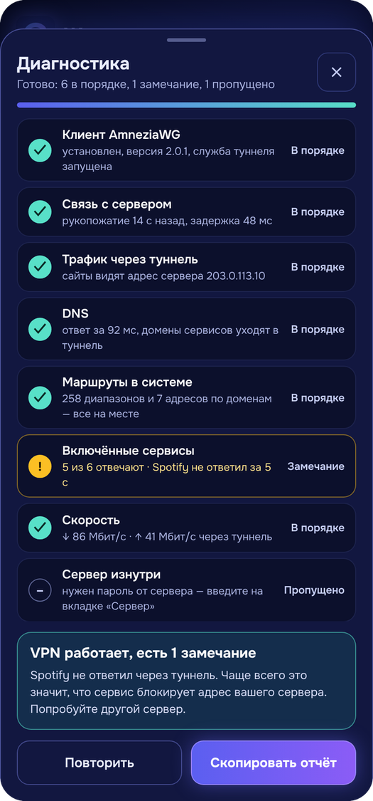
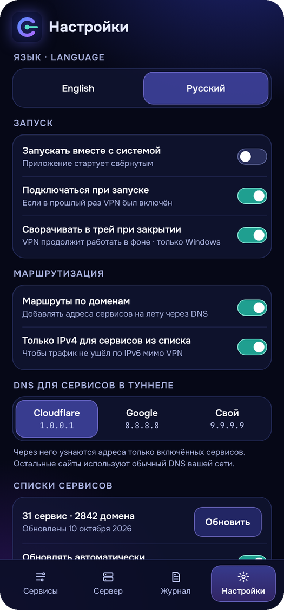

# ColdVPN

**Русский** · [English](README.en.md)

<p align="center">
  
  
  
  
  
</p>

| Сервисы | Свои ресурсы | Сервер | Диагностика | Настройки |
|---|---|---|---|---|
| Через VPN идёт только то, что включено | Любой список можно изменить или создать свой | Установка на VPS по адресу, логину и паролю | Восемь проверок с понятным итогом | Русский и английский, автозапуск, DNS |

VPN-клиент на AmneziaWG с выборочной маршрутизацией: приложение само ставит
VPN-сервер на ваш VPS и пускает через него только выбранные сервисы. Всё
остальное идёт напрямую через провайдера.

Текущая версия — **0.1.1**, для **Windows 10/11 (x64)** и **Android 8.0+**.

## Возможности

- **Установка сервера в один шаг.** Достаточно адреса VPS, логина и пароля:
  приложение зайдёт по SSH и поставит AmneziaWG в Docker.
- **Выборочная маршрутизация.** Ресурсы разложены по разделам (ИИ, общение,
  соцсети, развлечения, игры, системные), каждый включается отдельно. Есть
  режим «Весь трафик через VPN».
- **Свои разделы и ресурсы.** Любой раздел и ресурс можно переименовать,
  изменить или удалить, а также добавить свои — с собственными доменами,
  адресами и диапазонами. Ресурсы перетаскиваются внутри раздела и между
  разделами. Правки в готовых списках сохраняются при обновлении списков.
- **Маршруты по доменам** (Windows). Адреса сервисов добавляются в туннель
  на лету, когда программа обращается к домену из списка.
- **Режим «Приложения»** (Android). Через VPN целиком идут выбранные
  приложения телефона.
- **Несколько серверов** с быстрым переключением, флагом страны и городом.
- **Импорт и передача конфига**: файл `.conf`, QR-код или текст. Для друга
  или второго устройства можно выпустить отдельный ключ.
- **Диагностика**: клиент, связь с сервером, DNS, маршруты, доступность
  сервисов, скорость, состояние сервера.
- **Обновление списков сервисов** прямо из исходных репозиториев.
- Автозапуск, работа из трея, перенос настроек между устройствами.
- Интерфейс на русском и английском, язык переключается в настройках.

## Установка

Готовые файлы — в разделе
[Releases](https://github.com/ColdVision/ColdVPN/releases).

**Windows.** Скачайте `ColdVPN-Setup-<версия>.exe`. Установщик не подписан,
поэтому Windows покажет предупреждение SmartScreen: «Подробнее» →
«Выполнить в любом случае». Приложение запускается от имени администратора:
без этого нельзя установить службу туннеля и менять маршруты.

**Android.** Скачайте `ColdVPN-<версия>.apk` и откройте на телефоне. Система
попросит разрешить установку из этого источника — так бывает с любым
приложением не из магазина.

## Как пользоваться

1. Арендуйте VPS с Ubuntu или Debian.
2. Вкладка «Сервер» → «Установить на свой VPS»: введите IP-адрес, логин и
   пароль. Если сервер AmneziaWG уже есть, добавьте его конфиг файлом,
   QR-кодом или текстом.
3. На вкладке «Сервисы» включите нужные ресурсы и нажмите кнопку включения.
   На Windows при первом подключении приложение скачает и установит
   официальный клиент AmneziaWG.
4. Чтобы подключить телефон или второе устройство, на вкладке «Сервер»
   откройте меню сервера → «Поделиться» и выпустите отдельный ключ.

## Сборка из исходного кода

Нужны Windows 10/11 x64 и права администратора.

- `install_and_build.bat` — ставит недостающее (Git, Visual Studio Build
  Tools, Flutter) и собирает приложение в
  `build\windows\x64\runner\Release\`.
- `build_installer.bat` — то же самое и упаковка в установщик
  `dist\ColdVPN-Setup-<версия>.exe` (нужен Inno Setup, скрипт поставит его
  сам).
- `build_android.bat` — ставит JDK и Android SDK и собирает
  `dist\ColdVPN-<версия>.apk`. При первой сборке создаёт постоянный ключ
  подписи в папке `Документы\ColdVPN-signing`. Сохраните копию этой папки:
  обновление ставится поверх старой версии, только если ключ тот же.
- `publish_to_github.bat` — отправляет исходный код в репозиторий и
  помогает оформить выпуск.

Если инструменты уже установлены, достаточно:

```powershell
powershell -ExecutionPolicy Bypass -File tool\setup_windows.ps1
```

Тесты: `flutter test`.

## Как это устроено

- **Сервер.** `assets/install_awg.sh` поднимает контейнер на образе
  `amneziavpn/amneziawg-go`. Ключи и параметры маскировки создаются на
  сервере и хранятся в `/opt/splitvpn/awg`; повторная установка их не
  меняет. У каждого устройства свой ключ и адрес.
- **Клиент на Windows.** Туннель работает как служба официального клиента
  AmneziaWG. В конфиге `AllowedIPs` — это диапазоны включённых ресурсов,
  поэтому Windows добавляет маршруты только для них.
- **Клиент на Android.** Туннель поднимает встроенная библиотека
  AmneziaWG. В режиме «Сервисы» работают списки IP-адресов, в режиме
  «Приложения» через VPN идут выбранные приложения целиком.
- **Маршруты по доменам.** На время подключения приложение запускает
  локальный DNS-посредник и назначает его DNS-сервером туннеля. Когда
  программа спрашивает имя из списка включённого ресурса, посредник узнаёт
  его адреса, добавляет для них маршруты в туннель и только потом отвечает.
  Остальные имена разрешает обычный DNS системы.
- **Списки сервисов.** `assets/services.json` собирается из двух
  репозиториев по описанию в `assets/selection.json`. Приложение умеет
  обновлять списки само; вручную их пересобирает `tool/build_services.py`.

### Структура

| Путь | Что там |
|---|---|
| `lib/app_state.dart` | Состояние приложения, подключение, диагностика |
| `lib/awg_config.dart`, `lib/awg_manager.dart` | Конфиг туннеля и управление клиентом AmneziaWG |
| `lib/android_tunnel.dart`, `android_src/` | Туннель на Android |
| `lib/dns_proxy.dart` | DNS-посредник для маршрутов по доменам |
| `lib/l10n.dart` | Английский перевод: строки в коде написаны по-русски и служат ключами |
| `lib/server_installer.dart` | Установка сервера по SSH |
| `lib/list_updater.dart` | Обновление списков сервисов |
| `lib/secret_store.dart` | Хранение пароля сервера |
| `lib/desktop.dart` | Окно и значок в трее |
| `lib/ui/` | Экраны и общие элементы интерфейса |
| `assets/` | Списки, скрипты для сервера, шрифты, значки, флаги |
| `installer/`, `tool/` | Установщик и скрипты сборки |
| `docs/` | Снимки экрана и список изменений |

## Данные и безопасность

- Серверы, разделы, ресурсы и настройки хранятся в профиле пользователя
  (на Windows — `%APPDATA%\com.splitvpn\split_vpn`). Ключи серверов лежат
  там в открытом виде, как и в обычном конфиге WireGuard.
- Пароль от VPS сохраняется только по желанию. На Windows он шифруется
  защитой данных Windows (DPAPI) под текущую учётную запись, на Android
  хранится только до закрытия приложения.
- Страна и город сервера определяются одним запросом к ip-api.com, которому
  передаётся IP-адрес сервера. Место можно указать и вручную.
- Обновление списков скачивает архивы двух репозиториев с GitHub.

## Источники и благодарности

- Диапазоны IP: [RockBlack-VPN/ip-address](https://github.com/RockBlack-VPN/ip-address)
- Домены: [v2fly/domain-list-community](https://github.com/v2fly/domain-list-community)
- Протокол и клиент: [AmneziaWG](https://github.com/amnezia-vpn)
- Шрифты [Onest](https://fonts.google.com/specimen/Onest) и
  [JetBrains Mono](https://www.jetbrains.com/lp/mono/) — лицензия SIL OFL,
  тексты лежат в `assets/fonts/`
- Флаги: [hampusborgos/country-flags](https://github.com/hampusborgos/country-flags)
